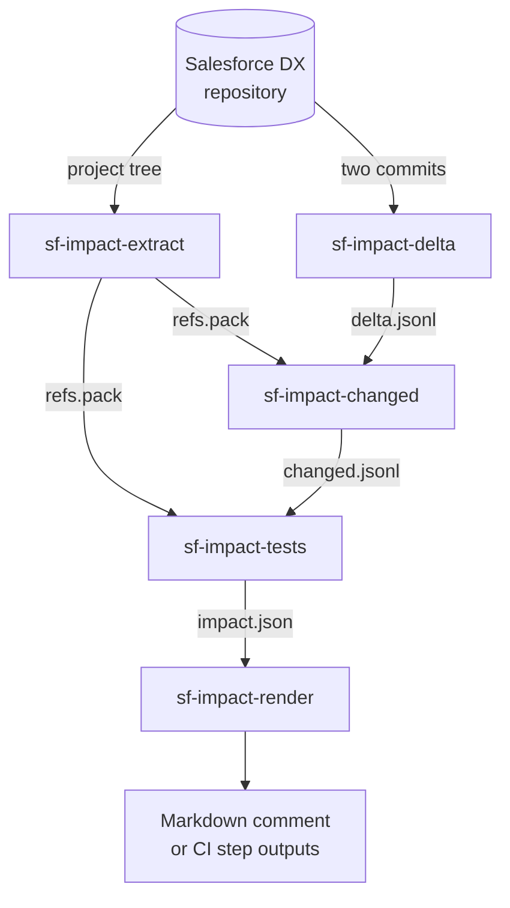

# sf-impact

Command-line tools for impact analysis on Salesforce DX repositories. Point
them at a project and they tell you **who references a symbol**, **what a diff
touches**, and **which Apex tests to run**, across Apex, Lightning Web
Components, Flows, objects and fields, permission sets, profiles and custom
metadata. They are small static programs with no server, no index and no
runtime to install: run them locally, or in CI on a pull request. They are for
Salesforce developers and release managers who want a pull request's test
selection and blast radius stated with evidence, instead of guessed.

Pre-release: the first version, `v0.1.0`, is not published yet.


<details>
<summary>The recording as text</summary>

```text
$ git log --oneline --decorate
ea09342 (HEAD -> round-circle) Round the area of a circle to four places
2c1f0fb (main) Import the project
$ sf-impact-extract --root . --out refs.pack
$ sf-impact-delta --merge-base main --head HEAD --out delta.jsonl
$ sf-impact-changed --delta delta.jsonl --refs refs.pack --out changed.jsonl
$ jq -c 'select(.row == "symbol") | {symbol, change}' changed.jsonl
{"symbol":"Circle.area()","change":"modified"}
$ sf-impact-tests --refs refs.pack --changed changed.jsonl --out impact.json
$ sf-impact-render --impact impact.json --format md | head -n 26
<!-- sf-impact -->
## Salesforce impact

| Head commit | Confidence | Selected tests | Untested symbols | Possible tests | Changed symbols |
| --- | --- | ---: | ---: | ---: | ---: |
| `ea0934234cad5efff2dc2c0eaadeb4ce947da384` | partial | 1 | 0 | 0 | 1 |

### Partial confidence (3 reasons)
…
### Selected tests (1)

- `ShapeServiceTest` (`force-app/main/default/classes/ShapeServiceTest.cls:1`): `caller`; seed `Circle.area()`
…
```

The commands and the abridged output of [docs/demo/demo.sh](docs/demo/demo.sh),
which runs the commands, built in release mode, on [fixtures/project](fixtures/project).

</details>

## How it works

Five tools, one job each, with a file between any two. The JSON Lines files can
be inspected with `jq`, and `sf-impact-extract --dump refs.pack` prints the
pack as text. A stage can be replaced, with one exception:
`sf-impact-changed` reads base declarations through the extractor library, so
replacing the extractor means replacing `sf-impact-changed` too (see
[docs/design.md](docs/design.md#2-principles)).



| Tool | Answers | Writes |
|---|---|---|
| [`sf-impact-extract`](docs/extract.md) | What is declared, and what refers to it? | `refs.pack` (`--format jsonl` writes `refs.jsonl` for reading only) |
| [`sf-impact-delta`](docs/delta.md) | What is not the same in two commits? | `delta.jsonl` |
| [`sf-impact-changed`](docs/changed.md) | Which symbols does that difference add, change or remove? | `changed.jsonl` |
| [`sf-impact-tests`](docs/tests.md) | Who references them, and which Apex tests cover them? | `impact.json` |
| [`sf-impact-render`](docs/render.md) | What should a reviewer read? | Markdown, or CI step outputs |

Every reference says how it was found (read from syntax, or matched as text),
and what could not be read lowers the reported confidence instead of being
dropped. The same tree gives byte-identical output. The tools never modify the
files of the repository they read. File outputs go where the caller says, with
`--out`, and `sf-impact-render` can print to standard output. The design is in [docs/design.md](docs/design.md).

## Install

`v0.1.0` is not published yet. Until it is, build from source with Rust 1.100.0:

```sh
cargo build --release --locked
```

The five commands are written to `target/release/`; copy them to a directory on
`PATH`.

Once `v0.1.0` is available:

```sh
curl -fsSL --proto '=https' --proto-redir '=https' https://raw.githubusercontent.com/adamdaw/sf-impact-releases/v0.1.0/install.sh -o install.sh
sh install.sh --version v0.1.0
```

The script installs all five commands into `~/.local/bin` (`--prefix` chooses
another directory), checks the archive's SHA-256 checksum before unpacking and
refuses a mismatch. It downloads over HTTPS only, so it needs curl. It needs no
sudo, npm or package manager and edits no shell profile. Git is needed to read
repository history. In CI, pin both the script URL and `--version` to the same
release tag.

[docs/install.md](docs/install.md) has the rest: the default `--version latest`,
the `sha256sum` or `shasum -a 256` prerequisite, what an archive contains, the
`.sha256` files and `SHA256SUMS`, supported platforms, and how to verify an
archive's GitHub attestation with `gh attestation verify`.

## Quick start

In a Salesforce DX repository, on a branch that is to be merged into `main`
(`--merge-base` needs the history of both, so fetch with full depth):

```sh
sf-impact-extract --root . --out refs.pack
sf-impact-delta --merge-base origin/main --head HEAD --out delta.jsonl
sf-impact-changed --delta delta.jsonl --refs refs.pack --out changed.jsonl
sf-impact-tests --refs refs.pack --changed changed.jsonl --out impact.json
sf-impact-render --impact impact.json --format md
```

`sf-impact-render` prints the pull request comment. Read **Selected tests**,
the Apex tests to run, and **Untested changed symbols**, which no test reaches;
**Partial confidence** lists what could not be read and may hide a reference.
These commands write `refs.pack`, `delta.jsonl`, `changed.jsonl` and `impact.json`
into the current directory. They are intermediate files: point `--out` at a
temporary directory, or add them to `.gitignore`.

`--format gh-step` prints `tests=…`, `selection=…` and counts for a CI step
instead. `impact.json` holds the complete evidence; keep it as an artifact.

To ask who references a symbol without a diff, skip the middle two stages:

```sh
sf-impact-tests --refs refs.pack --symbol Circle.area --out impact.json
sf-impact-render --impact impact.json --format md
```

On the bundled fixture project, the output lists the direct referrers of
`Circle.area()`, parsed ones first (under **Direct referrers**; the full output
also has the summary and the selected tests):

```text
- `Circle.area()` ← parsed `metadata_record` `Shipping_Plugin.Tracking` (`force-app/declarative/customMetadata/Shipping_Plugin.Tracking.md-meta.xml`)
- `Circle.area()` ← parsed `method` `BillingPlugin.firstSealArea()` (`plugins/Billing/classes/BillingPlugin.cls`)
- `Circle.area()` ← parsed `method` `BillingPlugin.sealArea()` (`plugins/Billing/classes/BillingPlugin.cls`)
- `Circle.area()` ← parsed `method` `ShapeService.describeAll(list<shape>)` (`force-app/main/default/classes/ShapeService.cls`)
- `Circle.area()` ← parsed `method` `ShapeService.firstArea(list<shape>)` (`force-app/main/default/classes/ShapeService.cls`)
- `Circle.area()` ← parsed `method` `ShapeService.lookupArea(string)` (`force-app/main/default/classes/ShapeService.cls`)
- `Circle.area()` ← parsed `method` `ShapeService.price(shape)` (`force-app/main/default/classes/ShapeService.cls`)
- `Circle.area()` ← parsed `method` `ShapeService.totalArea(list<shape>)` (`force-app/main/default/classes/ShapeService.cls`)
- `Circle.area()` ← textual `metadata_record` `Shipping_Plugin.Tracking` (`force-app/declarative/customMetadata/Shipping_Plugin.Tracking.md-meta.xml`)
```

That output is from the fixture; in your own repository, name a symbol that
exists in your refs pack. Every command has `--help`. `sf-impact-extract --jobs <n>` sets the worker
threads, and `sf-impact-extract --format jsonl` writes the refs as JSON Lines to
read or keep.

## Running in CI

A pull request job installs the five commands from one pinned release, runs the
pipeline above, posts the comment, and passes the selected tests to a validate
step. Nothing in it merges or deploys, and a fork's pull request fails visibly
instead of running with credentials. A hosted runner starts empty, so a job can
keep the refs pack in a cache and hand it to extract with `--previous`, which
then parses only the files whose bytes changed.

```sh
sf-impact-extract --root . --previous "$RUNNER_TEMP/refs.pack" --out "$RUNNER_TEMP/refs.pack"
```

The complete GitHub Actions workflow is in
[Example: GitHub Actions](docs/render.md#example-github-actions); caching the
pack is in [Reusing the previous pack, and running in CI](docs/ci.md).

## Trust model and security

A previous refs pack is trusted input: it is not authenticated, and a pack with
a valid checksum and structure is believed, including its stored rows. Restore
packs and caches only from trusted workflows and branches, such as the default
or base branch, never from fork code, and never store secrets in them.
Repository contents are untrusted too: malformed metadata or source can exhaust
CPU or memory, so run the tools without secrets in the environment.

Nothing has to be kept between runs. A file that is kept says what it is of, and
a run that it is not for refuses it: see
[What may persist](docs/persistence.md#what-may-persist). Report vulnerabilities
privately as described in [SECURITY.md](SECURITY.md).

## Documentation

| Page | Contents |
|---|---|
| [docs/install.md](docs/install.md) | Installing a release, building from source, verifying an archive |
| [docs/design.md](docs/design.md) | What it is, principles, the pipeline, release and platforms |
| [docs/extract.md](docs/extract.md) | `sf-impact-extract`: what it reads, which tree, declarative metadata, collisions |
| [docs/ci.md](docs/ci.md) | Reusing the previous pack, and running extract in CI |
| [docs/limits.md](docs/limits.md) | What extract does not resolve or read |
| [docs/delta.md](docs/delta.md) | `sf-impact-delta`: comparing two commits |
| [docs/changed.md](docs/changed.md) | `sf-impact-changed`: mapping a difference onto symbols |
| [docs/tests.md](docs/tests.md) | `sf-impact-tests`: referrers and test selection |
| [docs/render.md](docs/render.md) | `sf-impact-render`, and the GitHub Actions example |
| [docs/render-example.md](docs/render-example.md) | A rendered pull request comment, in full |
| [docs/pack.md](docs/pack.md) | The refs pack file format |
| [docs/persistence.md](docs/persistence.md) | What may be kept between runs |
| [docs/releases.md](docs/releases.md) | Builds, checksums, attestations, license policy |
| [docs/development.md](docs/development.md) | Fixtures, goldens and reconciliation runs |
| [docs/demo/demo.md](docs/demo/demo.md) | How the terminal recording above is made |
| [schema/](schema) | JSON Schemas of every file passed between the tools |

## Contributing

See [CONTRIBUTING.md](CONTRIBUTING.md) for the checks to run before opening a
pull request.

## License

MIT. See [LICENSE](LICENSE).

Release binaries include third-party code under its own licenses, among them
the MIT-licensed `tree-sitter-sfapex` grammar, whose published crate omits its
license file. Release archives carry [THIRD_PARTY_LICENSES](THIRD_PARTY_LICENSES),
generated from the lockfile by pinned cargo-about with an explicit
[license allow-list](about.toml) and the [upstream MIT notice](licenses/tree-sitter-sfapex-LICENSE).
